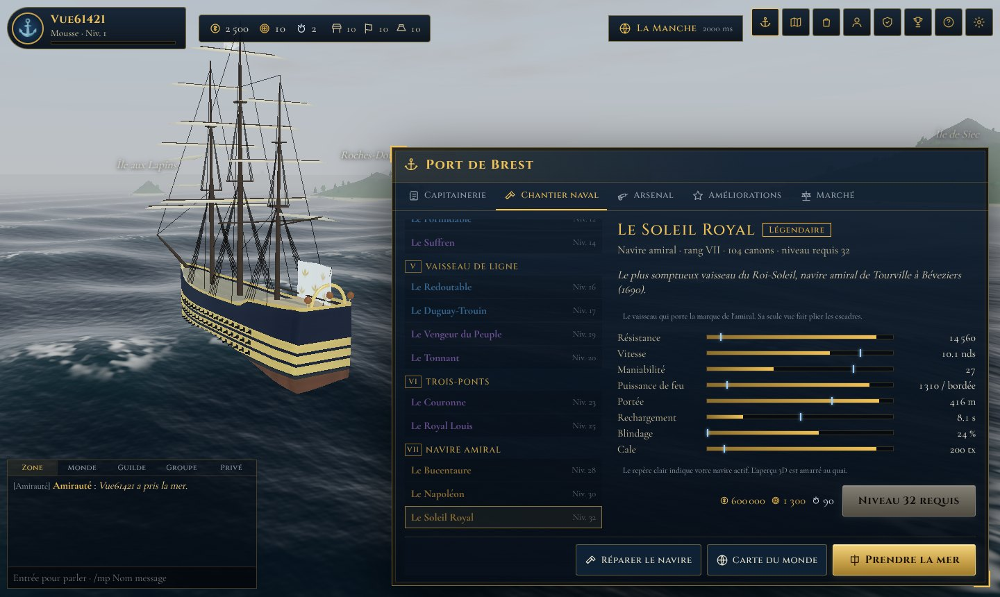
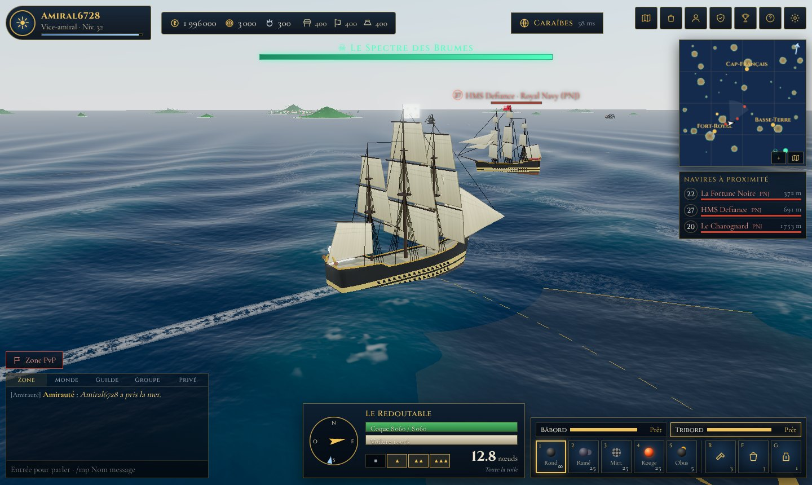
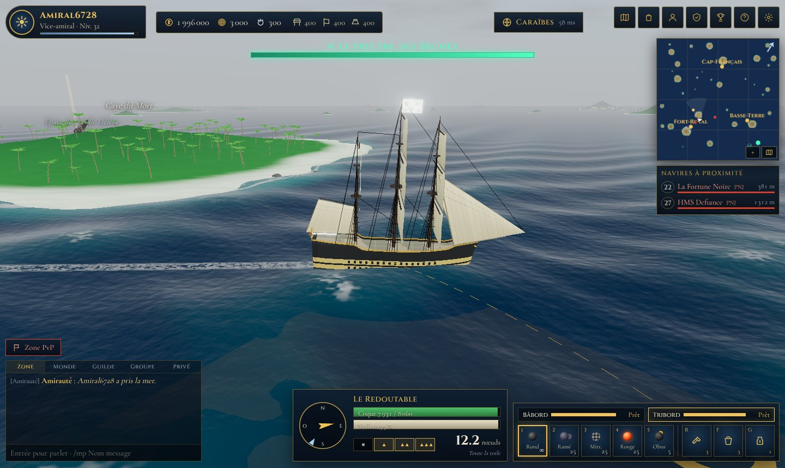
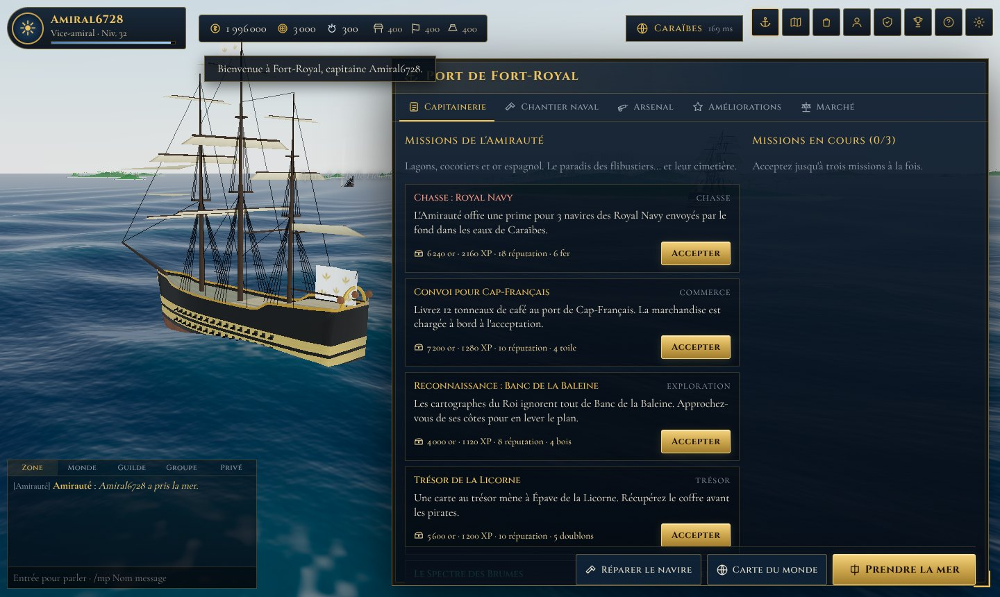
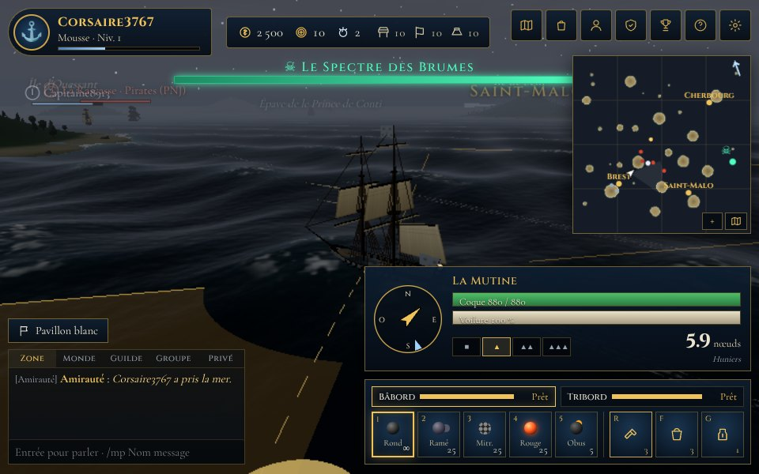
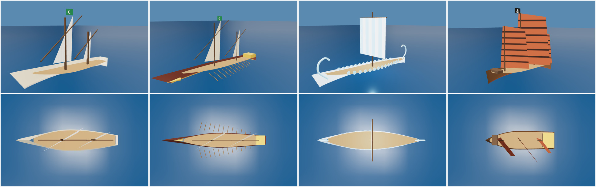

# ⚓ EMPIRE OF SEA

**Prototype jouable d'un MMORPG naval 3D, entièrement en français.**
De mousse à Grand Amiral de France : commandez des navires historiques de la marine française
(de la corvette *La Bayonnaise* au *Soleil Royal*), combattez pirates, Royal Navy et autres joueurs
dans un monde maritime ouvert et persistant.

## Aperçu (captures réelles du prototype)

| | |
|---|---|
|  |  |
|  |  |
|  |  |

## Lancer le jeu

Prérequis : **Node.js 22.5 ou plus récent** (la base de données SQLite est intégrée à Node, rien d'autre à installer).

```bash
npm install
```

```bash
npm start
```

Puis ouvrir **http://localhost:8080** dans Chrome, Edge ou Firefox (ordinateur).
`npm start` compile le client 3D puis démarre le serveur de jeu (HTTP + WebSocket sur le même port).

**Jouer à plusieurs :** chaque joueur ouvre la même adresse (sur le réseau local, remplacer `localhost`
par l'adresse IP de la machine qui héberge le serveur). Deux onglets de navigation privée sur le même PC
suffisent pour tester : chaque compte voit l'autre en temps réel.

Mode développement (rechargement à chaud du client et du serveur) :

```bash
npm run dev
```

puis ouvrir http://localhost:5173.

Variables d'environnement : `PORT` (8080 par défaut), `DB_FILE` (par défaut `data/empire.db`).

Aperçu d'une heure précise (purement visuel) : `http://localhost:8080/?heure=0.74` (coucher de soleil),
`?heure=0.5` (midi), `?heure=0.95` (nuit).

## Commandes

Le jeu se joue **à la souris**, en vue du dessus (la vue 3D derrière le navire reste disponible dans les Paramètres).

| Action | Commande |
|---|---|
| Naviguer | **clic gauche sur la mer** (le navire contourne les îles ; repère vert) |
| Attaquer | **clic gauche sur un ennemi** : avec l'attaque automatique, le navire présente le flanc et tire seul |
| Zoom / déplacer la vue | molette · clic droit glissé · touches caméra (T, G, F, H, 9 pour recentrer) |
| Barre rapide | 1 à 5 : munitions · 6 : réparation · 7 : pompes · 8 : poudre fine |
| Attaquer / annuler l'attaque | A / E (QWERTY : Q / E) |
| Cartes / Inventaire / Profil / Guilde / Classements | M / I / C / U / K |
| Accoster | P · pavillon de combat : B · chat : Entrée |

**Toutes les touches se modifient dans Paramètres** (cliquez sur une touche puis appuyez sur la nouvelle).

## Tutoriel

Au premier lancement, un encart guide le nouveau capitaine en 6 étapes, validées par le serveur et récompensées :
prendre la mer, naviguer, choisir une cible, couler un ennemi, lancer une compétence, rentrer au port
(3 200 or, 470 XP et 3 perles au total). Bouton « Passer » pour les habitués.

## Jouer sur téléphone ou tablette

1. Lancez le serveur sur le PC (`npm.cmd start`) : il affiche une ligne « 📱 Sur téléphone (même Wi-Fi) : http://192.168.x.x:8080 ».
2. Sur le téléphone connecté au même Wi-Fi, ouvrez cette adresse (Windows peut demander d'autoriser Node.js dans le pare-feu : acceptez pour les réseaux privés).
3. Tournez le téléphone à l'horizontale. Toucher la mer : naviguer ; toucher un ennemi : attaquer ; pincer : zoomer ; glisser à deux doigts : déplacer la vue.
4. « Ajouter à l'écran d'accueil » crée une icône. L'installation complète en plein écran (application) demande une adresse en HTTPS : ce sera le cas une fois le serveur mis en ligne.

## Interface en mer

- **Vue aérienne** (inclinée, nord en haut) : clic sur la mer pour naviguer, clic sur un ennemi pour l'attaquer
  (tir automatique). Molette : zoom ; clic droit glissé : déplacer la vue ; clic molette glissé ou touches `;` `:`
  (`,` `.` en QWERTY) : tourner la caméra ; X : recentrer ; V : vue 3D.
- Sous chaque navire : nom, niveau et barre de vie ; cercle vert en pointillés sous le vôtre, rouge sous la cible.
- **Haut** : niveau et expérience, or, doublons, perles, diamants, ressources, puis Menu, Port, Missions, Cartes bonus,
  Boutique, Événement, Classements, Tableau, Sortie. Graduations des secteurs sur les bords (200 m).
- **Gauche** : journal de bord (missions, objectifs, événements). **Droite** : mini-carte, ligne
  « (joueurs) carte secteur ⚓ », cible, navires à proximité, groupe, tableau.
- **Bas** : coque, **bouclier** (encaisse les dégâts avant la coque, se recharge 6 s après le dernier coup) et
  **énergie** (se régénère, sert aux compétences) ; munitions (1–7), **compétences** (A Z R S D en AZERTY) et objets
  (8–0) ; boutons Attaquer / Cesser le feu / Accoster.

### Classes de combat

| Classe | Rôle | Effet | Navires |
|---|---|---|---|
| Galion | Équilibré | +8 % coque et dégâts, +25 % de cale, +2 % blindage | Saint-Michel, Belle Poule, Duquesne, Formidable, Couronne, Bucentaure… |
| Frégate | Dégâts | +20 % dégâts, rechargement −10 %, +8 % vitesse, −10 % coque | Bayonnaise, Mutine, Cygne, Hermione, Suffren, Duguay-Trouin, Napoléon |
| Vaisseau de guerre | Résistance | +30 % coque, +6 % blindage, −10 % vitesse, −5 % dégâts | Redoutable, Vengeur du Peuple, Tonnant, Royal Louis, Soleil Royal |

### Compétences actives

| Touche (AZERTY) | Compétence | Niveau | Énergie | Recharge | Effet |
|---|---|---|---|---|---|
| A | Bordée concentrée | 1 | 35 | 25 s | canons rechargés, +30 % de dégâts 8 s |
| Z | Toutes voiles dehors | 2 | 25 | 30 s | +50 % de vitesse 8 s |
| R | Charpentiers à l'ouvrage | 4 | 40 | 45 s | +15 % de coque |
| S | Rempart de bordage | 7 | 50 | 60 s | recharge la moitié du bouclier |
| D | Tir de précision | 10 | 45 | 50 s | +40 % de coups critiques 10 s |

**Atelier du port** : chaque compétence se fabrique du niveau 1 au niveau 5 (or, ferraille, bois, toile, fer, puis perles) ;
chaque niveau renforce l'effet de 15 % et réduit la recharge de 8 %.

**Classements** : général (expérience) et **saison du mois** (1 point par navire coulé, 5 par capitaine coulé,
25 par boss ; remise à zéro le 1er de chaque mois).

Charte graphique : bleu abyssal #071725, bleu océan #103B56, bleu marine #162B42, or royal #C9A45C, ivoire #E9E0CC,
rouge combat #A83232, vert émeraude #34866B, gris acier #65727D, noir profond #090D12 ; titres Cinzel, textes Inter,
chiffres Roboto Condensed.

## Cartes

15 cartes : **1/1 à 5/2** par paires (/1 calme, /2 de guerre avec PvP libre et meilleur butin), puis **6, 7, 8, 9 et 10** (Océan Indien, Mer du Nord, Mer de Chine, Mer des Tempêtes, Mer des Brumes).
Chaque carte a ses propres ports français. La **mission de passage** de chaque étage (couler des ennemis à son
étage le plus haut et atteindre le niveau requis) débloque l'étage suivant. La guilde qui abat le boss d'une carte
en prend le contrôle (son blason s'affiche dans la grille des cartes). Les PNJ coulés réapparaissent 5 minutes plus tard.

## Grandes régions

| Région | Mers | Ennemis propres | Boss régional | Ressource |
|---|---|---|---|---|
| Côtes de France | Manche, Atlantique, Gascogne | pirates, Royal Navy | Le Spectre des Brumes | Toile de Bretagne |
| Méditerranée et Levant | Méditerranée (4/1), **Mer Égée** (4/2 : Candie, Navarin, Smyrne) | galères barbaresques, felouques | Le Colosse de Bronze | Huile d'olive du Levant |
| Amériques | Caraïbes | brigantins boucaniers | Le Roi des Flibustiers | Tabac des Amériques |
| Mers du Nord | Mer du Nord (7), Mer des Tempêtes (9) | corsaires de Dunkerque, baleiniers armés | Le Jarl des Glaces | Fourrures du Nord |
| Mers d'Asie | Océan Indien (6), Mer de Chine (8) | jonques de pirates | Le Dragon des Typhons | Thé et porcelaine de Chine |
| Mers lointaines | Mer des Brumes (10) | monstres, vaisseaux fantômes | Le Spectre des Brumes | Épices des Indes |

La région de chaque carte s'affiche dans l'écran Cartes (bande de couleur sous chaque case).
Les ennemis lointains ont leur propre silhouette 3D (`client/src/game/render/RegionalShipModel.ts`) : jonque à voiles
lattées, galère à rames animées et éperon, felouque à voiles latines, drakkar des glaces aux boucliers et volutes.



## Escadres et guerre de guildes

- **Escadre** : dans un groupe (onglet Groupe, 5 capitaines au plus), les membres peuvent « Suivre le chef en escadre » :
  leur navire prend place en formation en V derrière le chef et attaque automatiquement la même cible.
  Un clic sur la mer rompt la formation.
- **Bonus d'escadre** : +5 % de dégâts par allié (groupe, guilde ou alliance) à moins de 500 m, 3 alliés au maximum.
- **Raids de guildes** : toutes les 2 heures (heures paires, heure universelle), annoncés 10 minutes à l'avance,
  sur une carte de guerre (rotation). Pendant 15 minutes : combat libre pour tous hors des ports,
  10 points par capitaine coulé, 1 par navire PNJ. La guilde gagnante prend le contrôle de la carte
  et ses membres connectés reçoivent 20 000 or, 5 perles et 4 000 XP.
- **Territoires** : chaque carte contrôlée rapporte 250 × étage d'or toutes les 10 minutes aux membres connectés ; le contrôle des cartes est enregistré en base (il survit au redémarrage du serveur).
- **Repaire de guilde** : réparations gratuites dans les ports d'une carte contrôlée par sa guilde.
- On prend aussi une carte en abattant son boss (meilleur dégât de la guilde).

## Navires modernes (galerie)

Les 25 navires de la Marine nationale restent visibles en 3D dans **Flotte moderne** (rotation, zoom, export GLB),
mais ne sont pas jouables pour l'instant : les cartes modernes M1 à M5 ont été retirées.

| Catégorie | Navires |
|---|---|
| Voiliers | Belem, Belle Poule, Le Français, Le Mutin, L'Hermione |
| Pêche | Chalutier breton, Fileyeur, Chalutier hauturier, Caseyeur, Thonier senneur |
| Vedettes | rapide, de surveillance, garde-côte, d'interception, de sauvetage |
| Patrouilleurs | Aramis, Astérix, Marine, Loire, Atlantique |
| Frégates | type FREMM, type Horizon, type La Fayette, défense aérienne, polyvalente moderne |

Bouton **Flotte moderne** (menu, ou Chantier naval) : liste par catégorie, aperçu 3D (rotation 360°, zoom à la
molette), caractéristiques (PV, vitesse, accélération, maniabilité, blindage, puissance de feu, chargement), achat,
sélection et **export du modèle au format GLB** (ouvrable dans Blender ou tout logiciel 3D).

Organisation : catalogue et caractéristiques dans `shared/modern.ts` ; modèles générés par code dans
`client/src/game/render/ModernShipModel.ts` (coque acier, superstructures furtives, radars animés, niveaux de
détail : les petits éléments disparaissent au loin ; matériaux partagés entre tous les navires) ; choix du modèle
dans `render/factory.ts`. Les voiliers modernes réutilisent le générateur de gréements (`ShipModel.ts`, variantes
trois-mâts barque, goélette, dundee). En combat, les navires modernes tirent des obus traçants, les frégates des missiles.

## Équipement

Canons de **30 livres** (or), **50 livres** (perles) et **60 livres** (diamants), mâts de pin, de chêne et de Riga :
achat à l'Arsenal, installation au port (onglet Équipement) dans la limite de capacité du navire, et butin des PNJ
(plus riche sur les cartes hautes). Bureau de change : 10 doublons = 1 perle, 10 perles = 1 diamant.

## Ce que contient cette première version

**Monde et rendu 3D (Three.js)**
- Océan à houle de Gerstner (même formule sur le GPU et pour le tangage des navires), reflets du ciel,
  scintillement du soleil, écume des crêtes, eaux turquoise sur les hauts-fonds et ressac autour des îles.
- Ciel physique, cycle jour/nuit complet (levers et couchers de soleil, étoiles), nuages, brouillard,
  brume, tempêtes avec pluie et éclairs (météo décidée par le serveur, identique pour tous).
- Ombres dynamiques, reflets d'environnement, halo lumineux (bloom), tonalité cinématographique.
- 7 mers jouables, chacune avec son climat, sa végétation (pins bretons, oliviers et cyprès, palmiers…),
  ses îles, ses ports (villes, quais, églises, phares tournants la nuit), ses forts à la Vauban,
  ses repaires pirates et ses épaves.

**Navires**
- 18 navires jouables en 7 classes (corvette, brick, frégate, frégate lourde, vaisseau de ligne,
  trois-ponts, navire amiral), dont les 14 demandés : Soleil Royal, Bucentaure, Hermione, Redoutable,
  Vengeur du Peuple, Couronne, Royal Louis, Tonnant, Suffren, Formidable, Duquesne, Duguay-Trouin,
  Napoléon, Saint-Michel.
- Modèles 3D générés pour chacun : coque à membrures, préceintes et sabords, galerie de poupe éclairée la nuit,
  dorures, mâture à trois étages de voiles qui se déploient selon l'allure, gréement, canons en batterie,
  pavillon et flamme animés, lanternes, emblèmes peints sur les grand-voiles.
- Statistiques propres : vitesse, résistance, puissance de feu, nombre de canons, cale, maniabilité,
  rechargement, portée, blindage, rareté (commun → légendaire).

**Combat**
- Bordées bâbord / tribord avec rechargement séparé, visée balistique à la souris, 5 munitions,
  dispersion, coups critiques, dégâts de coque et de voilure (qui ralentissent), incendies,
  réparation, naufrage animé, butin à repêcher.
- Effets : éclairs de bouche, nuages de poudre qui dérivent avec le vent, boulets visibles, gerbes d'eau,
  éclats de bois, explosions, fumée des navires endommagés, secousses de caméra, sons synthétisés.
- PNJ (pirates, Royal Navy, barbaresques, flibustiers) qui manœuvrent pour présenter le flanc,
  anticipent la trajectoire et fuient parfois ; forts côtiers ; boss « Le Spectre des Brumes »
  à affronter à plusieurs, récompenses partagées selon les dégâts.

**Progression et économie**
- Or, doublons, perles, ressources de construction (bois, toile, fer).
- 40 niveaux, 14 grades (de Mousse à Grand Amiral de France), réputation, points de compétence.
- Port : capitainerie (missions de chasse, convoi, exploration, trésor, boss), chantier naval avec aperçu 3D
  à quai, arsenal, améliorations (coque, voiles, canons, boulets), compétences, marché avec prix par port,
  réparations, voyages entre les mers.

**Multijoueur**
- Serveur **autoritaire** : le client n'envoie que des intentions (barre, voilure, tir, achat) ;
  positions, dégâts, or et XP sont calculés uniquement par le serveur.
- Plusieurs joueurs dans la même mer, visibles en temps réel (prédiction locale + interpolation).
- Comptes (mots de passe hachés scrypt), sauvegarde en base SQLite, chat zone / monde / guilde / groupe / privé,
  guildes, alliances, guerres, groupes, PvP sur consentement ou libre selon la mer, classement mondial.
- Les PNJ sont toujours signalés « (PNJ) » : aucun bot ne se fait passer pour un joueur.

## Tests

```bash
npm test
```

Lance 9 tests : comptes, vrai serveur avec deux clients WebSocket (déplacement, tir, rechargement, chat,
messages invalides), physique, collisions, combat complet jusqu'au naufrage et aux récompenses,
règles PvP, économie.

```bash
npm run e2e
```

Test de bout en bout dans **deux vrais navigateurs** (nécessite Playwright et un serveur lancé) :
création de deux capitaines, sortie en mer, chacun voit l'autre, tirs. Captures dans `tests/screenshots/`.

## Architecture

Voir [docs/ARCHITECTURE.md](docs/ARCHITECTURE.md). En bref :

```
shared/   données et règles communes (navires, zones, physique, protocole, génération du monde)
server/   Node.js : HTTP + WebSocket, simulation autoritaire par zone, IA, économie, comptes, guildes, SQLite
client/   Vite + TypeScript : Three.js (rendu 3D) + React (interface)
tests/    tests serveur (node:test) et test navigateur (Playwright)
archive/  ancien prototype « Ombre des Mers » v0.6, conservé pour référence
```

## Limites connues de ce prototype

- Le rendu a été vérifié dans Chromium avec un moteur WebGL logiciel, pas sur une vraie carte graphique :
  le jeu sera beaucoup plus fluide sur un PC de jeu. Si besoin, *Paramètres → Qualité graphique*.
- La charge n'a pas été mesurée au-delà de quelques joueurs simultanés.
- Les modèles 3D sont procéduraux (générés par le code) : ils seront remplacés par des modèles réalisés
  par un artiste (format glTF) sans toucher au reste du jeu.
- Pas encore d'abordage, de flotte d'escorte, ni de version mobile.
