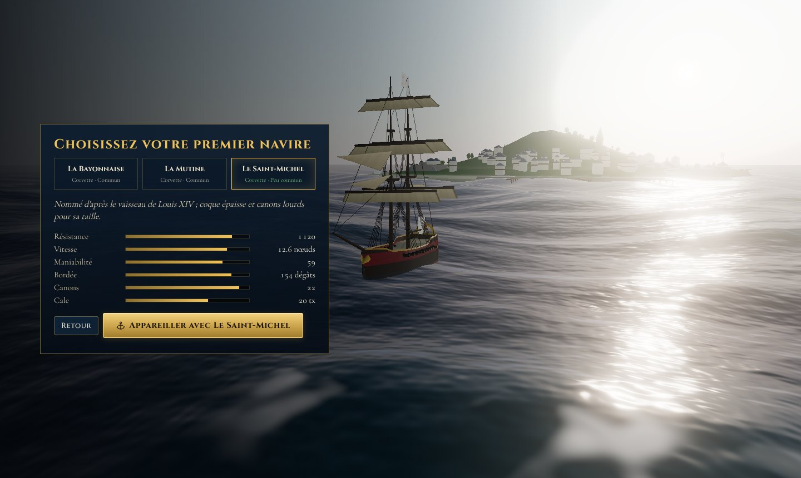

# ⚓ EMPIRE DES MERS

**Prototype jouable d'un MMORPG naval 3D, entièrement en français.**
De mousse à Grand Amiral de France : commandez des navires historiques de la marine française
(de la corvette *La Bayonnaise* au *Soleil Royal*), combattez pirates, Royal Navy et autres joueurs
dans un monde maritime ouvert et persistant.

## Aperçu (captures réelles du prototype)

| | |
|---|---|
|  |  |
|  |  |
|  |  |

## Lancer le jeu

Prérequis : **Node.js 22.5 ou plus récent** (la base de données SQLite est intégrée à Node, rien d'autre à installer).

```bash
npm install
```

```bash
npm start
```

Puis ouvrir **http://localhost:8080** dans Chrome, Edge ou Firefox (ordinateur).
`npm start` compile le client 3D puis démarre le serveur de jeu (HTTP + WebSocket sur le même port).

**Jouer à plusieurs :** chaque joueur ouvre la même adresse (sur le réseau local, remplacer `localhost`
par l'adresse IP de la machine qui héberge le serveur). Deux onglets de navigation privée sur le même PC
suffisent pour tester : chaque compte voit l'autre en temps réel.

Mode développement (rechargement à chaud du client et du serveur) :

```bash
npm run dev
```

puis ouvrir http://localhost:5173.

Variables d'environnement : `PORT` (8080 par défaut), `DB_FILE` (par défaut `data/empire.db`).

Aperçu d'une heure précise (purement visuel) : `http://localhost:8080/?heure=0.74` (coucher de soleil),
`?heure=0.5` (midi), `?heure=0.95` (nuit).

## Commandes

| Action | Touches (AZERTY / QWERTY) |
|---|---|
| Voilure + / − (4 allures) | `Z` / `S` (`W` / `S`) ou `↑` / `↓` |
| Barre à bâbord / tribord | `Q` / `D` (`A` / `D`) ou `←` / `→` |
| Viser | la souris sur l'eau : arc balistique et cible (or = prêt, rouge = rechargement) |
| Tirer la bordée visée | **clic gauche** |
| Double bordée | `Espace` |
| Bordée bâbord / tribord | `A` / `E` (`Q` / `E`) |
| Caméra | clic droit (ou gauche) glissé · molette pour le zoom · `V` suivi auto |
| Munitions | `1` boulet rond · `2` ramé · `3` mitraille · `4` boulet rouge · `5` obus |
| Équipements | `R` kit de réparation · `F` pompes (incendie) · `G` poudre fine |
| Accoster au port | `P` (près d'un quai) |
| Pavillon de combat (PvP) | `B` |
| Carte du monde / Inventaire / Profil / Guilde / Classement | `M` / `I` / `C` / `U` / `K` |
| Chat | `Entrée` (`/mp Nom message` pour un message privé) |

## Ce que contient cette première version

**Monde et rendu 3D (Three.js)**
- Océan à houle de Gerstner (même formule sur le GPU et pour le tangage des navires), reflets du ciel,
  scintillement du soleil, écume des crêtes, eaux turquoise sur les hauts-fonds et ressac autour des îles.
- Ciel physique, cycle jour/nuit complet (levers et couchers de soleil, étoiles), nuages, brouillard,
  brume, tempêtes avec pluie et éclairs (météo décidée par le serveur, identique pour tous).
- Ombres dynamiques, reflets d'environnement, halo lumineux (bloom), tonalité cinématographique.
- 7 mers jouables, chacune avec son climat, sa végétation (pins bretons, oliviers et cyprès, palmiers…),
  ses îles, ses ports (villes, quais, églises, phares tournants la nuit), ses forts à la Vauban,
  ses repaires pirates et ses épaves.

**Navires**
- 18 navires jouables en 7 classes (corvette, brick, frégate, frégate lourde, vaisseau de ligne,
  trois-ponts, navire amiral), dont les 14 demandés : Soleil Royal, Bucentaure, Hermione, Redoutable,
  Vengeur du Peuple, Couronne, Royal Louis, Tonnant, Suffren, Formidable, Duquesne, Duguay-Trouin,
  Napoléon, Saint-Michel.
- Modèles 3D générés pour chacun : coque à membrures, préceintes et sabords, galerie de poupe éclairée la nuit,
  dorures, mâture à trois étages de voiles qui se déploient selon l'allure, gréement, canons en batterie,
  pavillon et flamme animés, lanternes, emblèmes peints sur les grand-voiles.
- Statistiques propres : vitesse, résistance, puissance de feu, nombre de canons, cale, maniabilité,
  rechargement, portée, blindage, rareté (commun → légendaire).

**Combat**
- Bordées bâbord / tribord avec rechargement séparé, visée balistique à la souris, 5 munitions,
  dispersion, coups critiques, dégâts de coque et de voilure (qui ralentissent), incendies,
  réparation, naufrage animé, butin à repêcher.
- Effets : éclairs de bouche, nuages de poudre qui dérivent avec le vent, boulets visibles, gerbes d'eau,
  éclats de bois, explosions, fumée des navires endommagés, secousses de caméra, sons synthétisés.
- PNJ (pirates, Royal Navy, barbaresques, flibustiers) qui manœuvrent pour présenter le flanc,
  anticipent la trajectoire et fuient parfois ; forts côtiers ; boss « Le Spectre des Brumes »
  à affronter à plusieurs, récompenses partagées selon les dégâts.

**Progression et économie**
- Or, doublons, perles, ressources de construction (bois, toile, fer).
- 40 niveaux, 14 grades (de Mousse à Grand Amiral de France), réputation, points de compétence.
- Port : capitainerie (missions de chasse, convoi, exploration, trésor, boss), chantier naval avec aperçu 3D
  à quai, arsenal, améliorations (coque, voiles, canons, boulets), compétences, marché avec prix par port,
  réparations, voyages entre les mers.

**Multijoueur**
- Serveur **autoritaire** : le client n'envoie que des intentions (barre, voilure, tir, achat) ;
  positions, dégâts, or et XP sont calculés uniquement par le serveur.
- Plusieurs joueurs dans la même mer, visibles en temps réel (prédiction locale + interpolation).
- Comptes (mots de passe hachés scrypt), sauvegarde en base SQLite, chat zone / monde / guilde / groupe / privé,
  guildes, alliances, guerres, groupes, PvP sur consentement ou libre selon la mer, classement mondial.
- Les PNJ sont toujours signalés « (PNJ) » : aucun bot ne se fait passer pour un joueur.

## Tests

```bash
npm test
```

Lance 9 tests : comptes, vrai serveur avec deux clients WebSocket (déplacement, tir, rechargement, chat,
messages invalides), physique, collisions, combat complet jusqu'au naufrage et aux récompenses,
règles PvP, économie.

```bash
npm run e2e
```

Test de bout en bout dans **deux vrais navigateurs** (nécessite Playwright et un serveur lancé) :
création de deux capitaines, sortie en mer, chacun voit l'autre, tirs. Captures dans `tests/screenshots/`.

## Architecture

Voir [docs/ARCHITECTURE.md](docs/ARCHITECTURE.md). En bref :

```
shared/   données et règles communes (navires, zones, physique, protocole, génération du monde)
server/   Node.js : HTTP + WebSocket, simulation autoritaire par zone, IA, économie, comptes, guildes, SQLite
client/   Vite + TypeScript : Three.js (rendu 3D) + React (interface)
tests/    tests serveur (node:test) et test navigateur (Playwright)
archive/  ancien prototype « Ombre des Mers » v0.6, conservé pour référence
```

## Limites connues de ce prototype

- Le rendu a été vérifié dans Chromium avec un moteur WebGL logiciel, pas sur une vraie carte graphique :
  le jeu sera beaucoup plus fluide sur un PC de jeu. Si besoin, *Paramètres → Qualité graphique*.
- La charge n'a pas été mesurée au-delà de quelques joueurs simultanés.
- Les modèles 3D sont procéduraux (générés par le code) : ils seront remplacés par des modèles réalisés
  par un artiste (format glTF) sans toucher au reste du jeu.
- Pas encore d'abordage, de flotte d'escorte, ni de version mobile.
